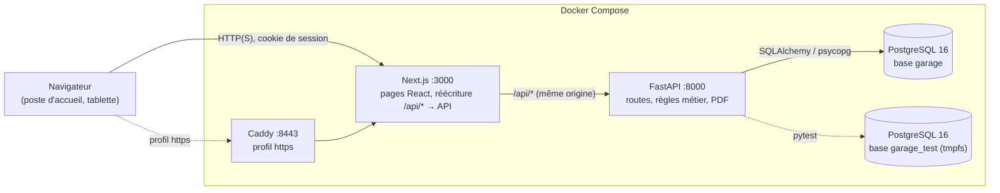

# Établi — gestion de garage automobile

Établi remplace le papier et le tableur d'un garage indépendant : fiches clients et véhicules,
rendez-vous par pont, ordres de travail suivis de l'accueil à l'atelier, devis calculés au
centime, factures numérotées sans trou et paiements. C'est le MVP d'un projet de cours mené en
Scrum par une squad de 5 personnes, en cinq sprints du 26 octobre au 24 décembre 2026 (version
`v1.0.0`, tag `sprint-4`). Toutes les données sont fictives.

| Couche | Technologie |
| --- | --- |
| Base de données | PostgreSQL 16 (Docker), migrations Alembic écrites à la main |
| API | Python 3.12, FastAPI, SQLAlchemy 2, Pydantic 2, reportlab (PDF) |
| Interface | Next.js 16 (App Router, TypeScript strict), TanStack Query, design system Établi |
| Tests | pytest (base dédiée), Vitest + Testing Library, Playwright |

Écrans principaux (maquettes du design system) : tableau de bord du gérant, planning du jour
par pont, fiche d'un ordre de travail avec son devis, vue tablette de l'atelier, facture et ses
paiements, recherche.

## Prérequis

- Docker Desktop (Windows, macOS) ou Docker Engine avec Compose v2 (Linux) ;
- Node.js 22 (22.20 en CI) et npm, seulement pour lancer les outils de l'interface depuis la
  machine (ESLint, TypeScript, Vitest, Playwright) ;
- les ports 3000 (interface), 8000 (API) et 5433 (PostgreSQL) libres.

## Démarrage rapide

```bash
cp .env.example .env                 # puis remplacer chaque valeur « a-changer »
docker compose up -d --build         # base, base de test, API, interface
docker compose exec api alembic upgrade head    # déjà fait au démarrage de l'API
docker compose exec api python -m app.cli seed  # comptes, clients, journée d'atelier, devis, factures
```

- Interface : http://localhost:3000
- API et documentation OpenAPI : http://localhost:8000/docs (résumé des routes : [docs/api.md](docs/api.md))
- HTTPS local (facultatif) : `COOKIE_SECURE=true` dans `.env`, puis
  `docker compose --profile https up -d` et https://localhost:8443 (certificat interne Caddy).

Le seed est rejouable : il remet à jour les fiches de démonstration sans rien dupliquer et ne
modifie jamais une facture émise. La journée d'atelier est datée du jour : relancé le matin de
la démo, il montre une journée crédible. Remise à zéro complète de la base de développement :

```bash
docker compose exec api alembic downgrade base
docker compose exec api alembic upgrade head
docker compose exec api python -m app.cli seed
docker compose restart api web    # les connexions ouvertes gardent des requêtes préparées sur l'ancien schéma
```

### Mode démonstration (build de production)

Pour une démonstration ou une recette, l'interface tourne sur son build de production, sans
sources montées ni rechargement à chaud :

```bash
docker compose -f docker-compose.yml -f docker-compose.demo.yml up -d --build web
docker compose up -d --build web     # retour au mode développement
```

Autres commandes : `python -m app.cli init-db` (schéma) et
`docker compose exec api python -m app.cli create-user --email … --nom … --role gerant|mecanicien`
(mot de passe de 12 caractères au moins, demandé deux fois).

## Comptes de démonstration

| Compte | Rôle | Mot de passe |
| --- | --- | --- |
| `nadia@garage.test` (Nadia Benali) | gérant | `DEMO_PASSWORD_GERANT` du fichier `.env` |
| `karim@garage.test`, `sophie@garage.test`, `lucas@garage.test` | mécaniciens | `DEMO_PASSWORD_MECANICIEN` du fichier `.env` |

Cinq mots de passe erronés bloquent un compte 15 minutes ; relancer le seed débloque les comptes
de démonstration.

## Fonctionnalités par rôle

**Gérant**
- tableau de bord de la journée : véhicules à l'atelier, prêts à restituer, retards, rendez-vous,
  facturé du jour, interventions filtrables, « À traiter maintenant » (retards, devis à faire
  valider, factures à établir, OT sans mécanicien), champ « Rechercher » ;
- clients (adresse facultative, alerte de doublon de téléphone, consentement aux rappels) et
  véhicules (immatriculation SIV unique, historique des interventions) ;
- rendez-vous par pont sans chevauchement, planning du jour, ouverture de l'OT depuis le rendez-vous ;
- ordres de travail `OT-AAAA-nnn` : demande, diagnostic, tâches, mécanicien, statut
  « En attente » → « En cours » → « Prêt » → « Livré » (une étape à la fois), suivi horodaté ;
- devis en centimes (HT, TVA 20 %, TTC) : brouillon → envoyé → accepté ou refusé ;
- facture `F-AAAA-nnn` sur un devis accepté d'une intervention terminée, PDF avec mentions
  légales, adresse du client et date de la prestation ;
- paiements partiels (carte au terminal, espèces, chèque, virement), reste à payer, statut
  impayée, partielle ou payée, retard après l'échéance ;
- recherche par nom (sans accents), téléphone, plaque (avec ou sans tirets), numéro d'OT ou de facture.

**Mécanicien**
- « Mes travaux » : ses OT, vue tablette (grandes cases, « Terminer l'intervention ») ;
- kanban de l'atelier, planning, fiches véhicules et historique ;
- aucun accès aux clients, devis, factures, paiements, recherche ni tableau de bord (403) ; il
  ne reçoit jamais de montant, ni le téléphone, l'e-mail ou l'adresse d'un client.

## Architecture



Le navigateur n'appelle que `/api/*`, relayé par Next.js vers FastAPI : même origine, cookies
`SameSite=Lax`, pas de CORS ouvert. Les règles métier pures (calcul du devis, transitions,
solde d'une facture, lecture de la recherche) vivent dans `api/app/services/` et sont testées
seules ; l'heure vient d'une horloge injectée (`app.clock.get_now`), ce qui permet de tester un
blocage de 15 minutes ou un retard d'échéance sans attendre.

## Organisation du dépôt

```
api/                 FastAPI
  app/models/        tables SQLAlchemy (une par agrégat)
  app/schemas/       entrées et sorties Pydantic
  app/routers/       routes HTTP (rôle exigé par routeur)
  app/services/      règles métier, numérotation, PDF, jeu de démonstration
  app/security/      hachage argon2id, jetons de session, CSRF, rôles
  alembic/versions/  migrations 0001 à 0015
  tests/             pytest, un fichier par story
web/                 Next.js
  src/app/           pages (App Router)
  src/components/    composants par domaine et composants du design system (ui/)
  src/lib/           appels à l'API, formats (« 454,80 € », « 17 h 30 »), règles d'affichage
  tests/unit/        Vitest + Testing Library
  tests/e2e/         Playwright (recette)
  design/            tokens et notes du design system Établi
docs/agile/          Definition of Done, tableau, backlog, comptes rendus, script de la démo
docs/uml/            modèle de données (Mermaid)
docs/api.md          routes par ressource, rôles et codes d'erreur
infra/               Caddy (HTTPS local)
```

## Règles garanties par la base

L'API vérifie chaque règle pour répondre clairement ; la base la garantit aussi, même en SQL
direct ou en cas de requêtes simultanées :

| Règle | Mécanisme |
| --- | --- |
| Numéros d'OT et de facture continus, sans trou | compteur verrouillé (`SELECT … FOR UPDATE`) dans la transaction qui crée le document |
| Pas deux rendez-vous qui se chevauchent sur un pont | contrainte `EXCLUDE USING gist` (btree_gist) |
| Immatriculation unique, e-mail d'employé unique | contraintes uniques (plaque normalisée, `citext`) |
| Au plus un devis non refusé par OT | index unique partiel |
| Facture et lignes non modifiables | triggers refusant UPDATE, DELETE, TRUNCATE et l'ajout d'une ligne après l'émission (SQLSTATE `ET001`) |
| Cumul des paiements ≤ TTC de la facture | trigger qui verrouille la facture avant chaque paiement (`ET002`) |
| Paiement non modifiable | trigger (`ET003`) ; corriger un paiement saisi par erreur est hors du MVP |
| Montants, quantités, kilométrage, code postal | contraintes `CHECK` (montants entiers en centimes) |

Détails et diagramme : [docs/uml/modele-donnees.md](docs/uml/modele-donnees.md).

## Sécurité et RGPD

- mots de passe hachés en argon2id ; 5 échecs → compte bloqué 15 minutes, message générique
  « Identifiants invalides » ;
- session dans un cookie httpOnly signé (`SameSite=Lax`, `Secure` derrière HTTPS), jeton CSRF
  « double submit » exigé sur toute requête qui modifie des données ;
- rôles vérifiés par l'API sur chaque route (403), l'interface ne fait que masquer ;
- minimisation des données : nom et téléphone obligatoires, e-mail et adresse facultatifs,
  consentement aux rappels jamais coché par défaut ; le mécanicien ne voit ni coordonnées ni
  montants ;
- aucune donnée de carte bancaire : « carte » désigne le terminal du garage ;
- données de démonstration fictives (domaine `exemple.test`, rues inventées), secrets
  uniquement dans `.env` (jamais versionné) ;
- factures conservées 10 ans (obligation comptable), donc immuables ; la suppression des
  données d'un client sur demande est prévue après le MVP.

## Tests et qualité

```bash
# API (sur la base garage_test, recréée à chaque session de tests)
docker compose exec api pytest -q
docker compose exec api pytest -q --cov=app --cov-report=term-missing   # couverture
docker compose exec api ruff check .
docker compose exec api ruff format --check .
docker compose exec api mypy app

# Interface (depuis web/)
npm ci
npm run lint && npm run typecheck && npm test && npm run build
```

La CI GitHub Actions (`.github/workflows/ci.yml`) rejoue ces contrôles à chaque push sur
`main` et `develop` et à chaque pull request.

### Recette de bout en bout (Playwright)

Les parcours de `web/tests/e2e/` (gérant du client au paiement, mécanicien sur la tablette,
contrôles d'accessibilité) tournent contre la pile Docker lancée et seedée ; ils ne sont pas
dans la CI. Ils créent leurs propres données à chaque exécution et se rejouent sans nettoyage.

```bash
docker compose restart web          # serveur de développement à jour
cd web
npx playwright install chromium     # une fois
npm run e2e
```

Variables utiles : `E2E_BASE_URL` (http://localhost:3000 par défaut), `E2E_MDP_GERANT` et
`E2E_MDP_MECANICIEN` si les mots de passe de démonstration du `.env` diffèrent de ceux de
l'équipe, `PW_CHROMIUM_PATH` pour utiliser un Chromium déjà installé quand le téléchargement
est impossible, par exemple
`C:\Users\<vous>\AppData\Local\ms-playwright\chromium_headless_shell-1234\chrome-headless-shell-win64\chrome-headless-shell.exe`.
Chaque exécution tire un identifiant au hasard (plaques, téléphones et noms « Recette… » en
découlent, sans dépendre de l'heure) ; `E2E_EXECUTION` (entier de 0 à 99 999) le fixe pour
rejouer une exécution à l'identique. Le rendez-vous du parcours du gérant est pris sur le
premier créneau libre du pont 3, lu dans les rendez-vous déjà enregistrés.

## Méthode et historique Git

- `main` : une version par fin de sprint, taguée `sprint-0` … `sprint-4` ;
- `develop` : intégration des stories ;
- `feature/<story>-<slug>` (et `fix/…`) : une branche par story, issue de `develop`, un commit
  par tâche du backlog au format Conventional Commits en français avec l'identifiant de la
  story (`feat(api): … [S4.4]`), fusionnée avec `git merge --no-ff` ;
- un correctif découvert en écrivant les tests part dans son propre commit `fix(...)` avant le
  commit `test:` ; l'historique n'est jamais réécrit.

Méthode : [Definition of Done](docs/agile/definition-of-done.md),
[tableau](docs/agile/tableau-kanban.md), [backlog](docs/agile/backlog.md), comptes rendus
([sprint 0](docs/agile/sprint-0.md), [1](docs/agile/sprint-1.md), [2](docs/agile/sprint-2.md),
[3](docs/agile/sprint-3.md), [4](docs/agile/sprint-4.md)), [script de la démo du 24 décembre](docs/agile/script-demo.md),
[journal des modifications](CHANGELOG.md).

## Dépannage

- **Une page répond 404 alors qu'elle existe (Docker Desktop sous Windows)** : le serveur
  Turbopack du conteneur ne voit pas toujours les fichiers modifiés depuis Windows. Pour une
  démonstration, utiliser le mode démonstration (build de production), qui n'a pas ce défaut.
  En développement, toucher la page dans le conteneur, par exemple
  `docker compose exec web touch "/app/src/app/(app)/recherche/page.tsx"`, ou repartir d'un
  cache propre : `docker compose down`, `docker volume rm etabli_web_next`, `docker compose up -d`.
- **Port déjà utilisé (5433, 3000 ou 8000)** : arrêter l'autre service, ou changer
  `POSTGRES_HOST_PORT` dans `.env` (pour 3000 et 8000, adapter `docker-compose.yml`).
- **Accents abîmés dans un fichier (PowerShell)** : `Set-Content` et `Out-File` écrivent par
  défaut dans l'encodage du système ou avec une marque BOM. Éditer les fichiers avec un éditeur
  réglé en UTF-8 sans BOM et fins de ligne LF (voir `.editorconfig` et `.gitattributes`).
- **Erreur 500 « cached plan must not change result type » après une remise à zéro** : l'API
  a gardé des connexions préparées sur l'ancien schéma ; `docker compose restart api`.
- **Compte de démonstration bloqué** : relancer `docker compose exec api python -m app.cli seed`.
- **La base de test est vide ou dans un état inattendu** : elle vit en mémoire ; pytest la
  recrée par les migrations à chaque session, ou `docker compose restart db-test`.
