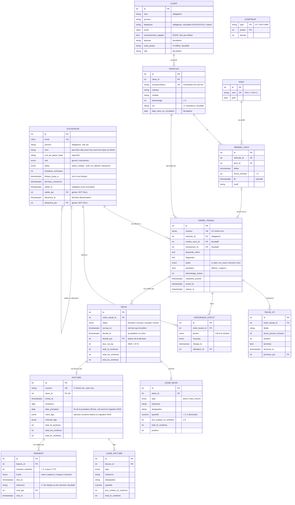
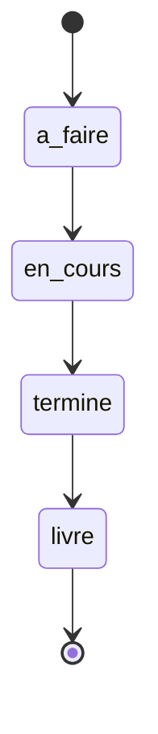
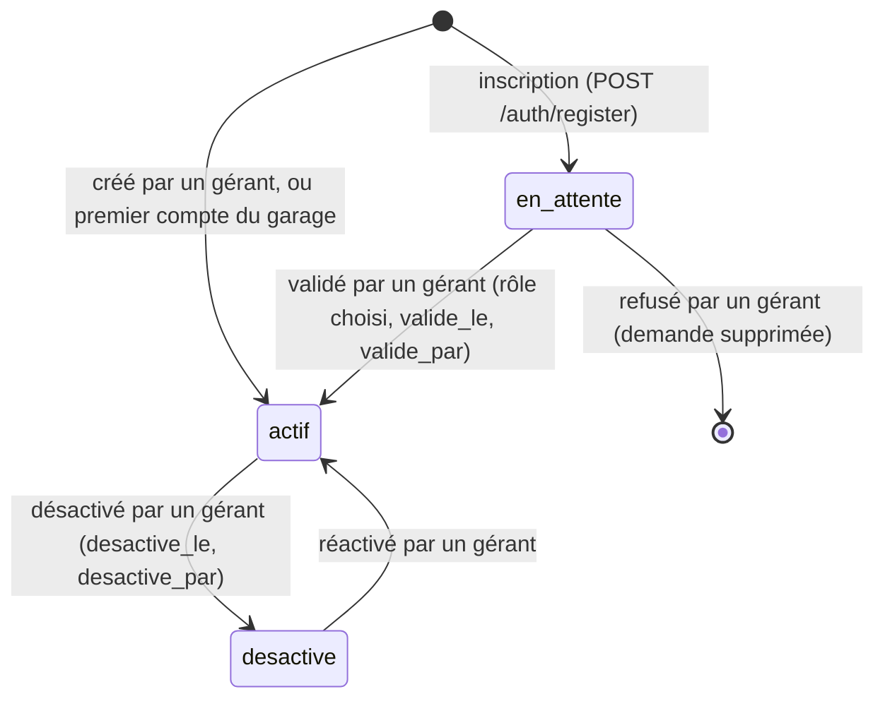
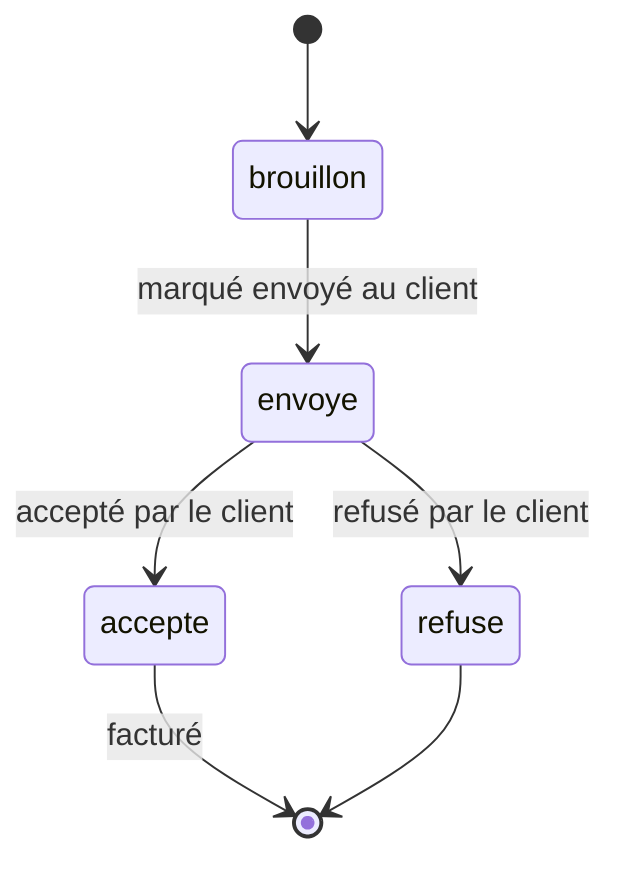

# Modèle de données

Base PostgreSQL 16. Les montants sont des **entiers en centimes**, les dates des `timestamptz`
stockées en UTC et affichées en Europe/Paris. Chaque table a une clé `id` (entier auto-incrémenté)
et, sauf mention contraire, `cree_le` / `modifie_le`.

## Règles portées par la base

| Règle | Mécanisme |
| --- | --- |
| E-mail utilisateur unique, sans tenir compte de la casse | `citext` + contrainte unique |
| Immatriculation unique | normalisation applicative (majuscules, tirets) + contrainte unique |
| Pas deux rendez-vous qui se chevauchent sur un même pont | `EXCLUDE USING gist (pont_id WITH =, tstzrange(debut, fin) WITH &&)` |
| Numéros d'OT et de facture continus, sans trou | table `compteur` verrouillée (`SELECT … FOR UPDATE`) dans la transaction d'insertion |
| Facture non modifiable | trigger `BEFORE UPDATE OR DELETE` qui lève une exception |
| Quantité > 0, prix ≥ 0, kilométrage ≥ 0, durée > 0 | contraintes `CHECK` |
| Un devis facturé au plus une fois | `facture.devis_id` unique |
| Au plus un devis non refusé par OT | index unique partiel `uq_devis_ordre_non_refuse` (`WHERE statut <> 'refuse'`) |
| Statut du devis cohérent avec ses dates | `CHECK statut_coherent` (brouillon sans envoi, envoyé daté, décision datée) |
| Cumul des paiements d'une facture ≤ son TTC | trigger `paiement_plafond` (BEFORE INSERT) qui verrouille la facture (`SELECT … FOR UPDATE`) puis refuse le dépassement (SQLSTATE `ET002`) |
| Paiement non modifiable | trigger `BEFORE UPDATE OR DELETE` et `BEFORE TRUNCATE` (SQLSTATE `ET003`) ; aucune donnée de carte n'est enregistrée (« carte » = terminal du garage) |
| Recherche sans accents ni casse, par morceau de nom, de téléphone ou de plaque | extension `unaccent`, fonction IMMUTABLE `etabli_normaliser`, index GIN `pg_trgm` (nom + prénom, téléphone, plaque sans tirets) |

## Statuts de l'ordre de travail

Transitions autorisées, une étape à la fois, sans retour :

Correspondance avec les badges du design system : `a_faire` → « En attente » (anneau),
`en_cours` → « En cours », `termine` → « Prêt », `livre` → « Livré ». `prioritaire = true` ajoute le
badge « Urgent » (losange) et la bande jaune `signal` sur la carte.

## Statut d'un compte

Stories S8.2 et S8.3, migration 0016. `statut` (type `statut_compte`) remplace le booléen
`actif` : une seule colonne fait foi (le modèle garde une propriété `actif` en lecture, vraie
pour le statut `actif`), et seul un compte actif ouvre une session, vérifié à chaque requête.
La migration a repris le prénom du nom existant, coupé au premier espace (« Nadia Benali » →
« Nadia » + « Benali », « Karim B. » → « Karim » + « B. ») : le nom affiché, prénom puis nom,
est inchangé. Le downgrade recolle prénom et nom et rend `actif = (statut = 'actif')`.

Badges : `actif` → « Actif » (`pret`), `en_attente` → « En attente de validation »
(`en-cours`), `desactive` → « Désactivé » (`livre`) ; un compte bloqué après 5 échecs porte en plus
« Bloqué jusqu'à 15 h 02 » (`urgent`). Il reste toujours au moins un gérant actif : l'API verrouille les
lignes des gérants actifs (`SELECT … FOR UPDATE`) avant de les compter.

## Statuts du devis

Story S4.2. Seul un brouillon se modifie ; seul un devis accepté se facture ; un devis refusé
peut être remplacé par un nouveau devis sur le même OT.

Badges : `brouillon` → « Brouillon » (anneau, `attente`), `envoye` → « Envoyé » (`en-cours`),
`accepte` → « Accepté » (`pret`), `refuse` → « Refusé » (`urgent`, couleur `danger`).
